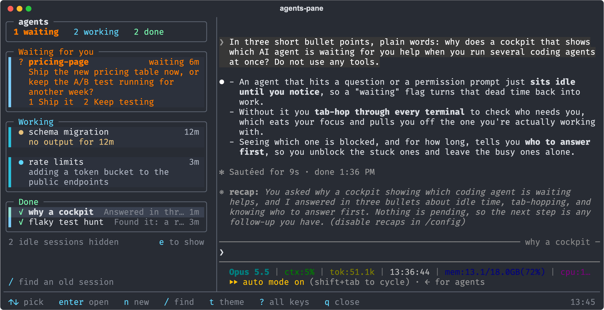
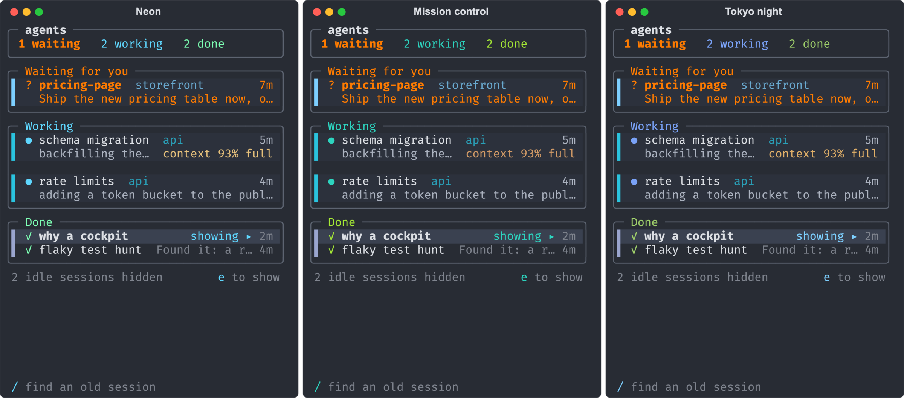
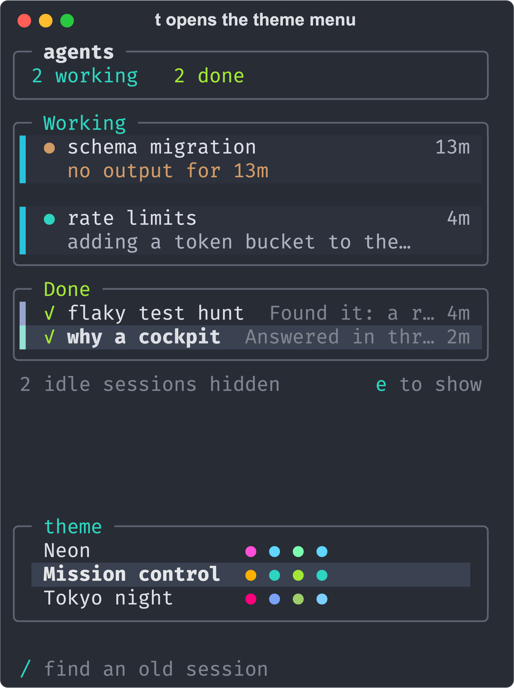

# agents-pane

A terminal dashboard for keeping track of several Claude Code sessions at once.

I usually have a few Claude Code sessions running in parallel, and I kept missing the moment one of them stopped to ask me something.
It would just sit there waiting in a tab I wasn't looking at.
So I built a split screen in tmux: all my sessions in a list on the left, with the ones waiting on me at the top, and the one I pick open on the right as the real Claude Code, where I can read it and type into it.



## What it does

- Lists every Claude Code session on your Mac, grouped into Waiting for you, Working, Done and Idle.
- Shows a session that's waiting on you (a question or a permission prompt) in orange, so you notice it.
- Opens the session you pick on the right, live; the others keep running in the background.
- Lets you start a new session, reply to one without opening it, or search old sessions by what they were about.
- Shows what each session is doing right now, and warns you when one is close to running out of context.
- Comes with three color themes.

It works everything out from the files Claude Code already writes, so there's nothing to keep updated by hand.



## Who it's for

I think it'd help anyone who runs a few Claude Code sessions at once.
It's built around how I work (macOS, tmux, sessions running in the background), so it might need some tweaks for yours.

## How I built it

I'm a college student, and I built this by directing Claude Code instead of writing the code by hand.
That only works if you don't take the AI's word for things, so I set it up to check its own work.
I wrote down what it should do and why in [`SPEC.md`](SPEC.md), had it write tests as it went (including screenshot tests that catch any unplanned change to the look), and had separate Claude sessions that hadn't written the code review it.
Those reviews caught real bugs, like a keyboard shortcut that a test build had quietly broken in my everyday setup.
I also used every version on my own sessions and sent it back whenever something bugged me.
It took a few rounds: the first version was a side panel I didn't like, the second had too many bold keys and borders, and this is the one I actually use.

## Install

It needs macOS (the only place I've run it), Python 3, tmux (a tool that splits one terminal window into panes), `rg` (ripgrep) and the `claude` CLI with background sessions (`claude --bg` and `claude attach`).
On a Mac, `brew install tmux ripgrep` covers the middle two.
I build and use it with tmux 3.7c, Python 3.14 and Claude Code 2.1.

**Sessions agents-pane starts or resumes skip Claude Code's permission prompts** (`--dangerously-skip-permissions`), so those agents edit files and run commands without asking first.
That's how I work; it's one line in `cockpit/tmuxctl.py` (`start`) if you'd rather they ask.

```sh
git clone https://github.com/jmtirador/agents-pane
cd agents-pane
python3 -m venv .venv && .venv/bin/pip install -r requirements.txt
bin/agents-pane
```

## Use

- `bin/agents-pane` opens the dashboard or comes back to it; `bin/agents-pane "prompt"` also starts a session in the current folder and shows it live.
- `↑↓` or `j k` pick a session, and the right side follows if it's running in the background; Enter opens any other one (an ended session restarts in the background), and the one you leave keeps running.
- Enter, Tab or Ctrl+] puts you in the live session; Ctrl+] again (or a click) brings you back to your sessions.
- `n` starts a session in any folder, `r` replies without opening it, and `/` finds old sessions by what they were about.
- `w` sends a Mac notification when a session finishes, `s` twice stops one (Enter brings it back), `x` twice deletes it for good, `e` shows the idle ones, `t` opens the theme menu, and `?` lists every key.
- In the live session, Ctrl+Z leaves it (it keeps running) and brings back the welcome screen, where you can start a new one.
- `q` leaves the dashboard; everything keeps running.
- `bin/find-session invoice export` searches old sessions for "invoice export" from any terminal.



## How it works

- `bin/agents-pane` builds a tmux session named `agents` (a tmux session, not a Claude one): the list on the left, the live pane on the right.
- `cockpit/sessions.py` (standard library only) reads the session registry, the background job files and the end of each transcript, and works out each session's state.
- `cockpit/app.py` is the list, built with Textual (a Python library for terminal apps): cards, dialogs, keys and clicks; `cockpit/view.py` draws the cards and `cockpit/model.py` holds the ordering rules, both pure and tested.
- `cockpit/live.py` owns the right pane and swaps `claude attach` and the welcome screen inside it, so tmux never re-creates a pane (tmux 3.7c can crash when it does).
- `cockpit/tmuxctl.py` holds the tmux and `claude` commands: the frame, the key bar, typing a reply, starting and stopping sessions.
- `docs/progress.md` is the build log, and `CHANGELOG.md` says what each version changed.

## Develop

```sh
.venv/bin/pip install -r requirements-dev.txt
git config core.hooksPath .githooks   # every commit runs make check and checks the message format
make check       # lint, unit tests, app tests and picture tests (seconds)
make check-all   # also the tmux tests, on a private tmux server with a fake claude (before every release)
```

- `tests/unit` covers the pure parts, `tests/app` runs the list app with tmux faked, and `tests/tmux` runs the real launcher on a private server; none of them touch your own tmux or sessions.
- `tests/app/test_pictures.py` compares each screen with the approved picture in `tests/app/__snapshots__/`; after you change the look on purpose, look at the failure report, then run `.venv/bin/python -m pytest tests/app/test_pictures.py --snapshot-update` and commit the new pictures.
- Commits follow Conventional Commits (`fix: …`, `feat: …`), and releases get a git tag and a `CHANGELOG.md` entry.

## License

MIT, see [`LICENSE`](LICENSE).
